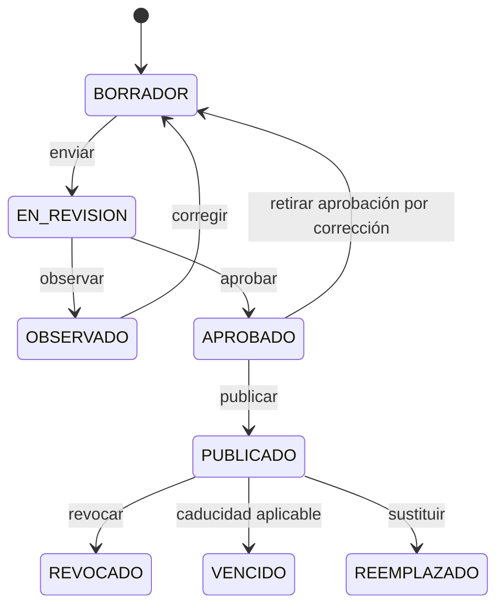

# 02 — Reglas de negocio y ciclo de vida

**Estado:** Aprobado técnicamente para MVP. La institución debe aprobar formalmente los criterios legales y operativos.

## Reglas
| ID | Regla |
|---|---|
| RN-01 | Cada certificado pertenece a un único emisor y a un titular; el titular puede tener múltiples certificados. |
| RN-02 | El identificador interno UUID no se expone como token de verificación. |
| RN-03 | El token público es aleatorio, de alta entropía, único e inmutable; no contiene DNI ni datos personales. |
| RN-04 | Solo certificados `PUBLICADO`, `REVOCADO`, `VENCIDO` o `REEMPLAZADO` tienen ficha verificable; los borradores no son públicos. |
| RN-05 | `REVOCADO` y `REEMPLAZADO` no se muestran como válidos. |
| RN-06 | `VENCIDO` solo aplica cuando el tipo de certificado tiene vigencia definida. |
| RN-07 | El certificado histórico conserva su fecha y documento originales; no se le agrega QR alterando su archivo histórico. |
| RN-08 | Un cambio de contenido tras aprobación exige nueva versión y nueva aprobación. |
| RN-09 | La revocación requiere motivo, usuario autorizado y sello temporal; no elimina el registro. |
| RN-10 | La sustitución vincula certificado anterior y nuevo y conserva trazabilidad. |
| RN-11 | La publicación requiere documento definitivo, titular, emisor, tipo, fecha, código y aprobación. |
| RN-12 | Se aplica segregación entre registrador y aprobador cuando el flujo de aprobación está habilitado. |
| RN-13 | La ficha pública solo muestra campos incluidos en una política de divulgación aprobada. |
| RN-14 | Búsquedas públicas por DNI y nombres están deshabilitadas por defecto; las internas requieren autorización y auditoría. |
| RN-15 | No se deduce falsificación de un resultado `NO_ENCONTRADO`; puede ser un certificado no incorporado al registro. |
| RN-16 | El número visible del certificado debe ser único por emisor y esquema de numeración, con excepción de formatos históricos formalmente conciliados. |
| RN-17 | Ningún documento completo se entrega desde rutas públicas permanentes; todo acceso completo requiere autorización, URL efímera y auditoría. |
| RN-18 | La política de divulgación se evalúa al momento de cada consulta pública, no se copia dentro del QR. |
| RN-19 | La observación de un certificado en revisión debe incluir comentario para el operador, sin exponer información sensible innecesaria. |
| RN-20 | Las exportaciones administrativas son operaciones sensibles: requieren permiso explícito, filtros acotados y evento de auditoría. |

## Máquina de estados

## Invariantes transaccionales
- `PUBLICADO` requiere `published_at`, `approved_by`, documento final y token único.
- `REVOCADO` requiere `revoked_at`, `revoked_by`, `revocation_reason`.
- `REEMPLAZADO` requiere referencia a certificado sucesor, sin ciclos.
- `APROBADO` requiere aprobador distinto del registrador cuando la segregación esté activa.
- `OBSERVADO` requiere motivo visible para el equipo interno y mantiene historial de revisión.
- Un mismo archivo puede tener varias versiones de metadatos, pero solo una versión documental marcada como definitiva para cada certificado publicado.
- La publicación y el evento de auditoría deben confirmarse en la misma transacción de BD; los efectos externos usan patrón outbox si corresponde.

## Campos públicos mínimos propuestos
Código institucional, nombre del titular (sujeto a evaluación de privacidad), denominación del certificado, institución emisora, fecha de emisión y estado. Documento completo y DNI son restringidos por defecto. La autoridad debe decidir si se enmascara el nombre o se requiere prueba adicional de posesión.

## Flujos especiales
**Corrección antes de publicar:** regresar a BORRADOR, versionar documento y volver a revisión.  
**Error detectado después de publicar:** revocar o reemplazar; nunca sobrescribir silenciosamente el PDF publicado.  
**Certificado no hallado:** mensaje neutral y canal institucional de consulta.  
**Compromiso de token:** revocar el token y emitir enlace nuevo con registro de auditoría; documentar impacto sobre QR impresos.
