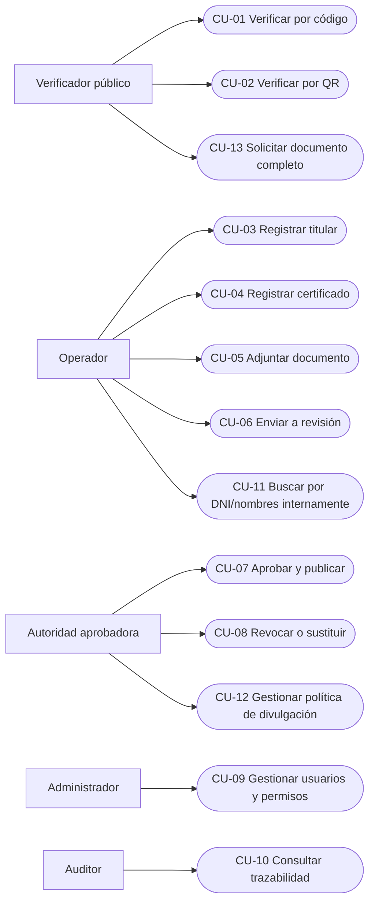

# 03 — Casos de uso

**Estado:** Aprobado técnicamente para MVP.

## Diagrama general

> Mermaid representa aquí las relaciones actor-caso de uso mediante flowchart, ya que no existe una sintaxis UML use-case universalmente soportada por Mermaid.

## CU-01 — Verificar por código
**Actor:** público. **Precondición:** servicio disponible. **Disparador:** ingresar token/código.  
**Flujo principal:** (1) introducir código; (2) validar formato y límites; (3) buscar certificado; (4) aplicar política de divulgación; (5) mostrar estado, emisor y datos permitidos; (6) registrar evento agregado sin exceso de datos personales.  
**Alternativas:** código inexistente -> mensaje neutral; borrador -> no revelar existencia; revocado -> mostrar estado no válido; exceso de intentos -> 429.  
**Postcondición:** no se modifica el certificado.

## CU-02 — Verificar por QR
**Actor:** público. **Precondición:** QR contiene URL HTTPS oficial.  
**Flujo:** (1) escanear; (2) abrir URL `/v/{token}`; (3) aplicar flujo CU-01.  
**Excepción:** QR con dominio no oficial -> advertencia fuera del sistema; se debe formar al usuario para comprobar el dominio.

## CU-03 — Registrar titular
**Actor:** operador. **Flujo:** buscar por documento -> verificar coincidencias -> crear/actualizar -> guardar auditoría. **Excepciones:** duplicado; datos insuficientes; permisos.

## CU-04 — Registrar certificado
**Actor:** operador. **Precondición:** titular existente. **Flujo:** seleccionar tipo/emisor -> capturar datos y origen histórico/nuevo -> validar -> crear BORRADOR. **Excepciones:** numeración duplicada, fecha inválida.

## CU-05 — Adjuntar documento
**Actor:** operador. **Flujo:** solicitar subida -> verificar MIME real/tamaño/antimalware -> guardar objeto privado -> hash -> vincular versión. **Excepciones:** archivo malicioso o corrupto, fallo de almacenamiento.

## CU-06 — Enviar a revisión
**Actor:** operador. **Precondición:** datos mínimos completos. **Flujo:** validar consistencia -> transición EN_REVISION -> notificar aprobador. **Excepción:** falta documento definitivo.

## CU-07 — Aprobar y publicar
**Actor:** autoridad. **Precondición:** EN_REVISION, política de divulgación activa y no ser registrador cuando aplique segregación. **Flujo:** inspeccionar datos y PDF -> aprobar -> publicar -> generar/confirmar token y QR -> auditar. **Excepción:** observación devuelve a OBSERVADO con motivo interno.

## CU-08 — Revocar o sustituir
**Actor:** autoridad. **Precondición:** PUBLICADO. **Flujo:** elegir acción y motivo -> confirmación reforzada -> actualizar estado -> conservar evidencia -> verificar que QR refleja estado nuevo. **Excepción:** permiso insuficiente.

## CU-09 — Gestionar usuarios
**Actor:** administrador. **Flujo:** crear/desactivar cuenta -> asignar rol permitido -> registrar cambio. **Restricción:** administración técnica no implica permiso de emisión.

## CU-10 — Consultar auditoría
**Actor:** auditor. **Flujo:** filtrar por certificado, usuario, acción y período -> ver historial sin editar. **Excepción:** acceso fuera de ámbito -> 403.

## CU-11 — Búsqueda interna por identidad
**Actor:** operador autorizado. **Flujo:** autenticar -> justificar/filtros -> buscar por DNI o nombres -> resultados paginados -> abrir expediente permitido -> auditar consulta. **Restricción:** no es endpoint público.

## CU-12 — Gestionar política de divulgación
**Actor:** autoridad o administrador autorizado. **Precondición:** existe aprobación institucional/legal de campos públicos. **Flujo:** crear versión de política -> definir campos visibles y reglas de documento completo -> revisar -> activar -> auditar cambio. **Excepciones:** política incompleta; intento de activar sin permiso; falta de evidencia de aprobación.

## CU-13 — Solicitar documento completo
**Actor:** público o usuario autorizado, según política. **Precondición:** certificado verificable y política permite acceso completo. **Flujo:** solicitar acceso -> validar condición/autorización -> generar URL efímera o registrar rechazo -> auditar. **Restricción:** no se publica object key ni URL permanente.
