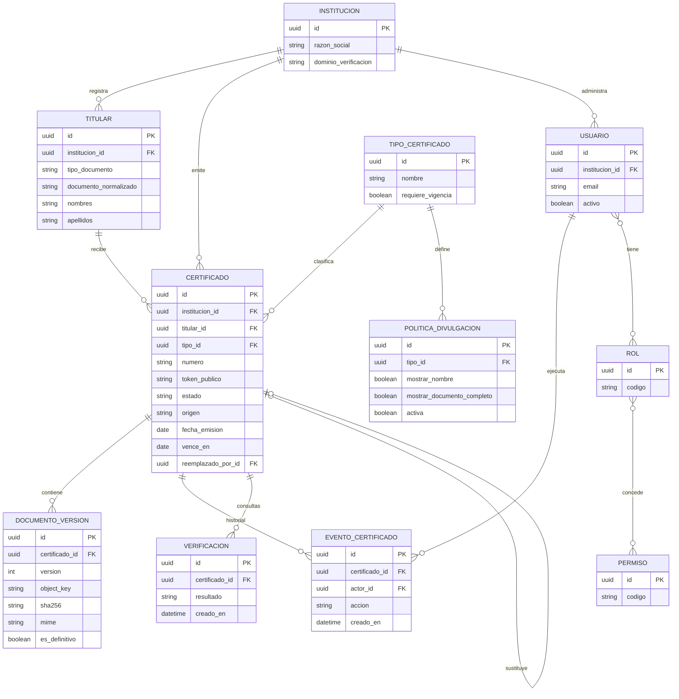

# 04 — Modelo de datos relacional y ER

**Motor:** PostgreSQL 16+ aprobado técnicamente para MVP. IDs internos UUID. Timestamps `timestamptz` UTC.

## Diagrama entidad-relación

## Tablas detalladas
### institucion
`id uuid PK`, `razon_social text NOT NULL`, `nombre_comercial text`, `dominio_verificacion text NOT NULL`, `activo boolean`.

### titular
`id uuid PK`, `institucion_id uuid FK`, `tipo_documento varchar(16)`, `documento_normalizado varchar(32)` (cifrado o protección adicional según análisis), `nombres text`, `apellidos text`, `created_at`, `updated_at`; UNIQUE `(institucion_id,tipo_documento,documento_normalizado)` para documentos no nulos. Índices de búsqueda interna sujetos a estrategia de privacidad.

### tipo_certificado
`id`, `institucion_id`, `codigo`, `nombre`, `requiere_vigencia boolean`, `activo`; UNIQUE `(institucion_id,codigo)`.

### certificado
`id uuid PK`, `institucion_id`, `titular_id`, `tipo_id`, `numero_institucional`, `token_publico` UNIQUE nullable hasta publicación, `origen` (`HISTORICO`,`NUEVO`), `estado`, `titulo`, `programa`, `fecha_emision date`, `vence_en date nullable`, `registrado_por`, `aprobado_por`, `approved_at`, `published_at`, `revoked_at`, `revoked_by`, `revocation_reason`, `reemplazado_por_id uuid FK certificado nullable`, `created_at`, `updated_at`, `row_version int`; UNIQUE `(institucion_id,numero_institucional)` sujeto a política de históricos. `CHECK (vence_en IS NULL OR vence_en >= fecha_emision)`.

### documento_version
`id`, `certificado_id`, `version int`, `object_key text`, `sha256 char(64)`, `mime`, `size_bytes bigint`, `es_definitivo boolean`, `uploaded_by`, `created_at`; UNIQUE `(certificado_id,version)` y UNIQUE parcial `(certificado_id) WHERE es_definitivo=true`. Object keys no deben contener nombres personales.

### politica_divulgacion
`id`, `institucion_id`, `tipo_id nullable`, `version int`, `activa boolean`, `mostrar_nombre boolean`, `nombre_mascara varchar(32)`, `mostrar_codigo boolean`, `mostrar_fechas boolean`, `mostrar_programa boolean`, `permitir_documento_completo boolean`, `requiere_autorizacion_documento boolean`, `aprobado_por`, `approved_at`, `created_at`; UNIQUE parcial por institución/tipo donde `activa=true`. La política activa se consulta en cada verificación pública.

### usuario / rol / permiso
`usuario(id,institucion_id,email,password_hash nullable,activo,mfa_enabled,created_at)`; `rol(id,codigo,nombre)`; `permiso(id,codigo)`; `usuario_rol(usuario_id,rol_id)`; `rol_permiso(rol_id,permiso_id)`. Si se integra SSO, usar `identity_provider` y `external_subject`.

### evento_certificado
`id`, `certificado_id`, `actor_id nullable`, `accion`, `estado_anterior`, `estado_nuevo`, `motivo`, `metadata_jsonb` (sin secretos), `request_id`, `created_at`. Solo INSERT desde aplicación; política de retención y protección contra manipulación.

### verificacion
`id`, `certificado_id nullable`, `resultado` (`VALIDO`,`NO_VALIDO`,`NO_ENCONTRADO`), `canal` (`CODIGO`,`QR`), `created_at`, `ip_hash_temporal nullable`, `request_id`. Preferir agregados y retención breve para evitar rastreo de visitantes.

### sesion_acceso_documento
`id`, `certificado_id`, `documento_version_id`, `solicitado_por nullable`, `motivo`, `expires_at`, `created_at`, `used_at nullable`, `request_id`. Registra accesos autorizados a documentos completos sin convertir el archivo en público.

## Integridad y concurrencia
- Claves foráneas con `ON DELETE RESTRICT` para certificados y evidencias; desactivación lógica en lugar de borrado.
- Transiciones protegidas por `row_version` o `SELECT FOR UPDATE`.
- Tokens aleatorios generados con CSPRNG, >=128 bits de entropía, codificados URL-safe; índice UNIQUE.
- Restricciones de estados/fechas en aplicación y, donde sea posible, CHECK/trigger en BD.
- Índices parciales para garantizar una sola política de divulgación activa por alcance.
- Migraciones Alembic versionadas y revisadas.

## Índices
`certificado(token_publico)` UNIQUE; `certificado(institucion_id,numero_institucional)` UNIQUE; `certificado(titular_id,fecha_emision DESC)`; `certificado(estado,created_at)`; `evento_certificado(certificado_id,created_at DESC)`. Búsqueda por nombres: índice trigram solo en esquema interno con controles de acceso.

## Datos personales
DNI y nombre no forman parte del token público ni de las URLs. Definir cifrado, minimización y acceso a documentos completos tras evaluación legal y de amenazas.
