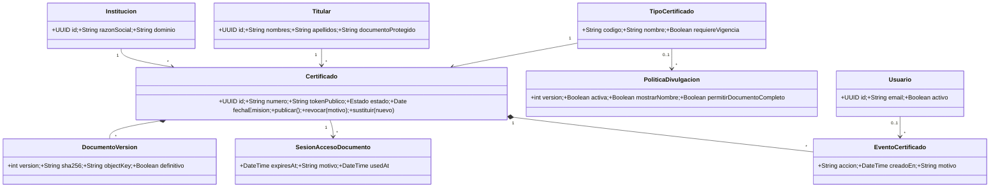
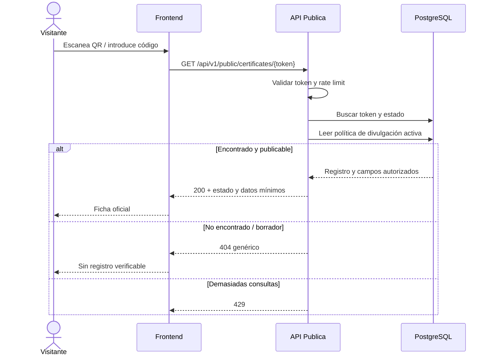
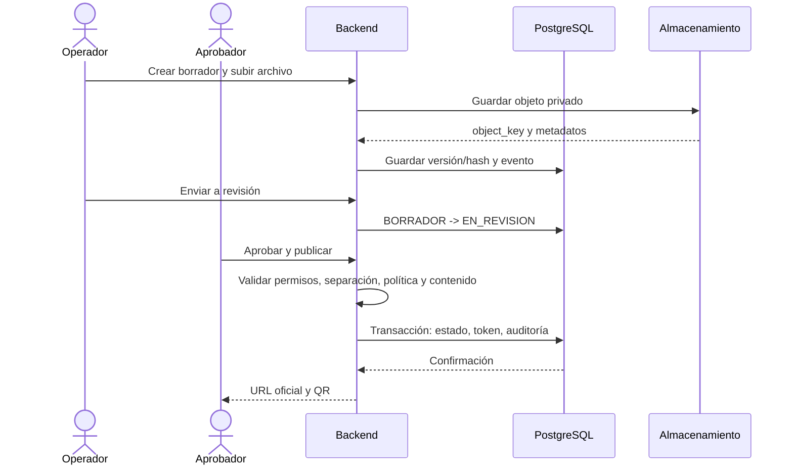
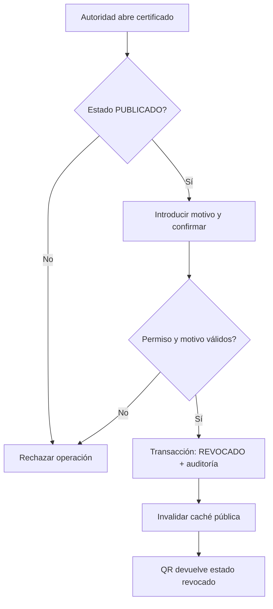
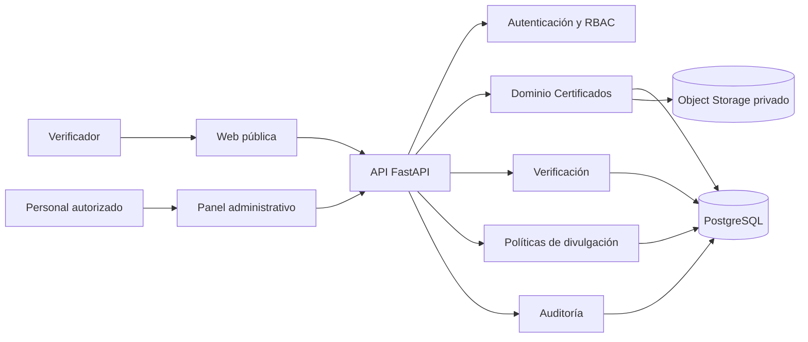

# 05 — Diagramas UML y flujos

**Estado:** Aprobado técnicamente para MVP.

## 1. Diagrama de clases de dominio

## 2. Secuencia de verificación pública

## 3. Secuencia de publicación

## 4. Actividad de revocación

## 5. Contexto y componentes

## Notas de modelado
- Diagramas UML conceptuales: no reemplazan las especificaciones de endpoints ni las restricciones SQL.
- Para generar código, usar como contrato conjunto los archivos 01, 02, 04 y 07.
- Si un cambio altera un estado, actualizar todos los diagramas relacionados y la matriz de pruebas.
