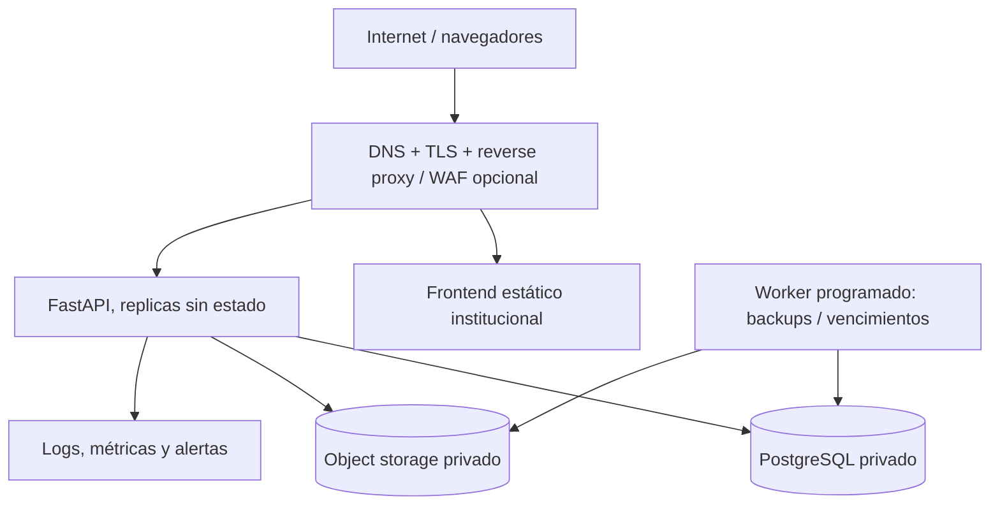

# 06 — Documento de arquitectura de software (SAD)

**Estilo:** monolito modular con API REST. **Estado:** aprobado técnicamente para MVP.

## 1. Drivers arquitectónicos
Seguridad de datos personales; verificación pública confiable; trazabilidad de emisión; integridad documental; integración con web institucional; operación sencilla; evolución futura hacia emisión por plantillas.

## 2. Stack propuesto
Frontend React + Vite + Tailwind; backend Python 3.12+ / FastAPI / Pydantic / SQLAlchemy / Alembic; PostgreSQL; almacenamiento de objetos privado compatible con S3; reverse proxy HTTPS; CI/CD GitHub Actions o equivalente. Versiones concretas se fijan al iniciar implementación y se actualizan mediante política de dependencias.

## 3. Vista de despliegue

**Regla:** BD y almacenamiento no se exponen a Internet; solo la API necesaria. URLs firmadas efímeras para archivos restringidos. No servir documentos desde carpetas públicas.

## 4. Límites modulares del backend
```text
backend/app/
  main.py
  core/            # config, seguridad, errores, DB, observabilidad
  modules/
    identity/      # cuentas, roles, permisos
    holders/       # titulares
    certificates/  # registro, estado, emisión, revocación
    documents/     # subida, versiones, hash, almacenamiento
    verification/  # consultas públicas y QR
    disclosure/    # políticas de campos públicos y acceso efímero
    audit/         # eventos, informes
  integrations/    # storage, correo opcional, firma futura
  tests/
```
Cada módulo expone `router`, `service`, `repository`, `schemas`, `models`; la lógica de negocio reside en servicios/dominio, no en controladores HTTP. Dependencias unidireccionales; evitar acceso directo a tablas de otros módulos fuera de interfaces definidas.

## 5. Vista frontend
`/verificacion` formulario; `/v/:token` ficha pública; `/admin/login`; `/admin/titulares`; `/admin/certificados`; `/admin/revision`; `/admin/auditoria`. Usar API central; no colocar secretos en variables Vite (`VITE_*` es público).

## 6. Seguridad por diseño
- Autenticación administrativa mediante OIDC institucional si existe; de lo contrario sesiones seguras y MFA para autoridades. Evaluar expiración, rotación y bloqueo de intentos.
- RBAC y autorización por recurso, separación operador/aprobador.
- TLS, HSTS, CSP, cabeceras seguras, CORS solo orígenes aprobados.
- Validación de entradas, consultas parametrizadas, límites de tamaño y tipo de archivo, escaneo antimalware.
- Almacenamiento privado con cifrado en reposo y control de claves.
- Tokens QR aleatorios; no PII en URL; no depender del QR como prueba criptográfica.
- Limitación de tasa por IP/cliente y protección antienumeración; observabilidad sin almacenar datos excesivos.
- Auditoría con controles de integridad y privilegios de solo adición; backup externo.
- Revisión de Ley 29733 y reglamento peruano vigente por responsable legal antes de publicar campos personales.

## 6.1 Línea base de privacidad y amenazas
Antes del primer despliegue productivo se debe completar un threat model ligero con al menos: enumeración de tokens, IDOR/BOLA, exposición accidental de documentos, abuso de búsquedas internas, falsificación visual de QR, robo de credenciales de aprobador y filtración en logs. Los controles mínimos del MVP son: tokens de alta entropía, rate limit, RBAC por recurso, MFA para roles críticos, object storage privado, URLs efímeras, eventos de auditoría y mensajes públicos neutrales.

## 7. Consistencia e integridad
PostgreSQL es fuente de verdad de estados. Publicar/revocar requiere transacción que incluye evento de auditoría. El objeto se sube antes de la transacción y se limpia si queda huérfano; operaciones asíncronas con outbox si se integran notificaciones. Evitar caché prolongada de estados públicos; usar `Cache-Control: no-store` para fichas sensibles.

## 8. Entornos y CI/CD
`local`, `staging`, `production` con BD y credenciales separadas. Pipeline: lint, type-check, unitarias, integración PostgreSQL, migraciones, análisis de dependencias, escaneo secretos, despliegue a staging, pruebas smoke, aprobación a producción. Backups verificados antes de migraciones destructivas.

## 9. Operación
Health endpoints `/health/live` y `/health/ready`; alertas de errores 5xx, saturación, consultas anómalas y fallos de almacenamiento. Objetivos RPO/RTO, escalado, retención y SLA pendientes de aprobación. Definir procedimiento de restauración y respuesta a incidentes.

## 9.1 Calidad de entrega
Cada incremento debe incluir migración reversible cuando aplique, pruebas unitarias de reglas de estado, pruebas de autorización para endpoints nuevos, contrato OpenAPI actualizado y smoke test manual documentado. No se acepta funcionalidad administrativa sin evento de auditoría cuando modifique certificados, usuarios, documentos o políticas de divulgación.

## 10. Evolución
Fase 2: generación por plantillas, firma digital integrada, importación masiva, notificaciones. Fase 3 solo si se justifica: API institucional para terceros, integración con ERP académico o arquitectura multiinstitución. No introducir microservicios sin métricas que lo sustenten.
